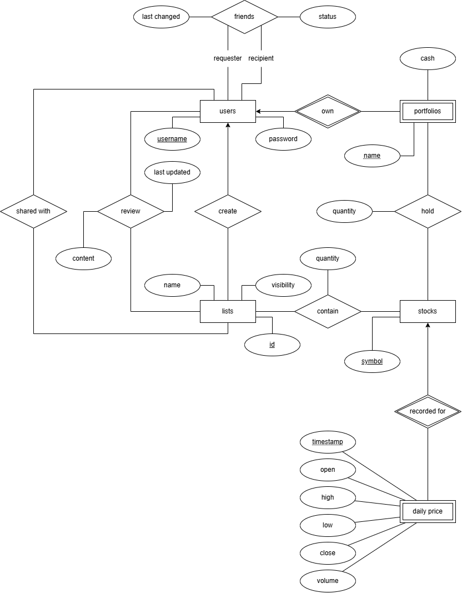

# Project Written Tasks

## Task 1 - E/R Modeling

### Note the following:

- Passwords are not stored in the database, only their salted hashes
- Sharing of lists is allowed only between friends
- A list creator can review their own list
- Friend status could be one of: pending, accepted, rejected, removed
- Users must name their portfolios uniquely
- New daily stock information goes in the same entity as the historical data

## Task 2 - Relational Schema

### Entities

**users**(<u>username</u>, password)

**portfolios**(<u>username</u>, <u>name</u>, cash)\
Foreign Key: username references users(username), on delete cascade

**stocks**(<u>symbol</u>)

**daily_prices**(<u>symbol</u>, <u>timestamp</u>, open, high, low, close, volume)\
Foreign Key: symbol references stocks(symbol), on delete cascade

**lists**(<u>id</u>, creator, name, visibility)\
Foreign Key: creator references users(username), on delete cascade

### Relationships

**friends**(<u>requester</u>, <u>recipient</u>, status, last_changed)\
Foreign Key: requester references users(username), on delete cascade\
Foreign Key: recipient references users(username), on delete cascade

**holds**(<u>username</u>, <u>portfolio_name</u>, <u>symbol</u>, quantity)\
Foreign Key: (username, portfolio_name) references portfolios(username, name), on delete cascade\
Foreign Key: symbol references stocks(symbol)

**contains**(<u>list_id</u>, <u>symbol</u>, quantity)\
Foreign Key: list_id references lists(id), on delete cascade\
Foreign Key: symbol references stocks(symbol)

**reviews**(<u>list_id</u>, <u>username</u>, content, last_updated)\
Foreign Key: list_id references lists(id), on delete cascade\
Foreign Key: username references users(username), on delete cascade

**shared_with**(<u>list_id</u>, <u>username</u>)\
Foreign Key: list_id references lists(id), on delete cascade\
Foreign Key: username references users(username), on delete cascade

### Caching Tables

Not in the ERD since these are derived data and not entities. These tables only cache already computed results to save processing time.

**stock_stats**(<u>symbol</u>, <u>start_date</u>, <u>end_date</u>, cov, beta)\
Foreign Key: symbol references stocks(symbol), on delete cascade

**pair_stats**(<u>symbol1</u>, <u>symbol2</u>, <u>start_date</u>, <u>end_date</u>, covariance, correlation)\
Foreign Key: symbol1 references stocks(symbol), on delete cascade\
Foreign Key: symbol2 references stocks(symbol), on delete cascade

### Note the following:

- If A and B appear as (requester, recipient) in the _friends_ table, then (B, A) will not appear (no duplicates allowed)
- Similarly, if stocks A and B are a pair in the _pair_stats_ table, then they will be sorted lexicographically (preventing duplicates)

## Task 3 - Normalization

### Entities

**users**(username, password)

We have the implied FD username → password.  
Take username⁺, we get {username, password}.

Thus username is a superkey, and users satisfies BCNF.

**portfolios**(username, name, cash)

We have the implied FD (username, name) → cash.  
Take (username, name)⁺, we get {username, name, cash}.

Thus (username, name) is a superkey, and portfolios satisfies BCNF.

**stocks**(symbol)

There are no nontrivial FDs.

Thus stocks trivially satisfies BCNF.

**daily_prices**(symbol, timestamp, open, high, low, close, volume)

We have the implied FD (symbol, timestamp) → (open, high, low, close, volume).  
Take (symbol, timestamp)⁺, we get {symbol, timestamp, open, high, low, close, volume}.

Thus (symbol, timestamp) is a superkey, and daily_prices satisfies BCNF.

**lists**(id, creator, name, visibility)

We have the implied FD id → (creator, name, visibility).  
Take id⁺, we get {id, creator, name, visibility}.

Thus id is a superkey, and lists satisfies BCNF.

### Relationships

**friends**(requester, recipient, status, last_changed)

We have the implied FD (requester, recipient) → (status, last_changed).  
Take (requester, recipient)⁺, we get {requester, recipient, status, last_changed}.

Thus (requester, recipient) is a superkey, and friends satisfies BCNF.

**holds**(username, portfolio_name, symbol, quantity)

We have the implied FD (username, portfolio_name, symbol) → quantity.  
Take (username, portfolio_name, symbol)⁺, we get {username, portfolio_name, symbol, quantity}.

Thus (username, portfolio_name, symbol) is a superkey, and holds satisfies BCNF.

**contains**(list_id, symbol, quantity)

We have the implied FD (list_id, symbol) → quantity.  
Take (list_id, symbol)⁺, we get {list_id, symbol, quantity}.

Thus (list_id, symbol) is a superkey, and contains satisfies BCNF.

**reviews**(list_id, username, content, last_updated)

We have the implied FD (list_id, username) → (content, last_updated).  
Take (list_id, username)⁺, we get {list_id, username, content, last_updated}.

Thus (list_id, username) is a superkey, and reviews satisfies BCNF.

**shared_with**(list_id, username)

There are no nontrivial FDs.

Thus shared_with trivially satisfies BCNF.

### Caching Tables

**stock_stats**(symbol, start_date, end_date, cov, beta)

We have the implied FD (symbol, start_date, end_date) → (cov, beta).  
Take (symbol, start_date, end_date)⁺, we get {symbol, start_date, end_date, cov, beta}.

Thus (symbol, start_date, end_date) is a superkey, and stock_stats satisfies BCNF.

**pair_stats**(symbol1, symbol2, start_date, end_date, covariance, correlation)

We have the implied FD (symbol1, symbol2, start_date, end_date) → (covariance, correlation).  
Take (symbol1, symbol2, start_date, end_date)⁺, we get {symbol1, symbol2, start_date, end_date, covariance, correlation}.

Thus (symbol1, symbol2, start_date, end_date) is a superkey, and pair_stats satisfies BCNF.

### Conclusion

Under our stated functional dependency assumptions, every nontrivial FD has a superkey as its LHS.

Therefore, all relations satisfy BCNF and no decomposition is needed.

## Task 4 - Queries in Relational Algebra

We define the following five actions:

1. Viewing all friend usernames of a user
2. Viewing all list names created by a user
3. Viewing all portfolios of a user
4. Viewing a specific stock's full price history
5. Viewing all stock symbols of a portfolio

### Query 1 - Viewing All Friend Usernames of a User

Given a username u:

- Make a new relation A(friend) by selecting all tuples in friends where requester = u and status = accepted, then projecting recipient.
- Make a new relation B(friend) by selecting all tuples in friends where recipient = u and status = accepted, then projecting requester.
- Take the union of A and B.

A(friend) = πrecipient(σrequester = u ∧ status = 'accepted'(friends))

B(friend) = πrequester(σrecipient = u ∧ status = 'accepted'(friends))

Then get the result A ∪ B

### Query 2 - Viewing All List Names Created by a User

Given a username u, select all tuples in lists where creator = u, then project the name attribute.

πname(σcreator = u(lists))

### Query 3 - Viewing All Portfolios of a User

Given a username u, select all tuples in portfolios where username = u.

σusername = u(portfolios)

### Query 4 - Viewing a Specific Stock's Full Price History

Given a stock symbol s, select all tuples in daily_prices where symbol = s.

σsymbol = s(daily_prices)

### Query 5 - Viewing All Stock Symbols of a Portfolio

Given a username u and a portfolio name p, select all tuples in holds where username = u and portfolio_name = p, then project the symbol attribute.

πsymbol(σusername = u ∧ portfolio_name = p(holds))
